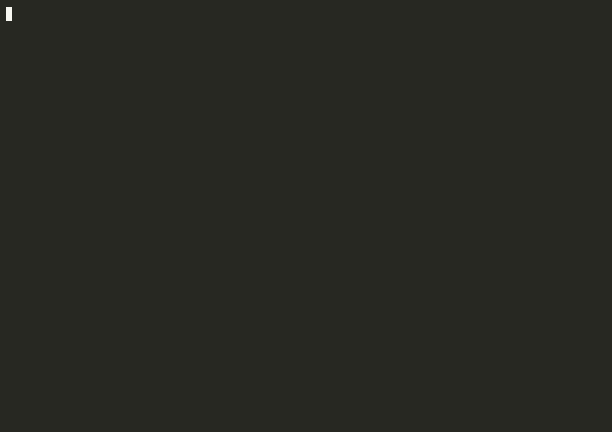

# volley

volley is a test runner for `clojure.test` on babashka and the JVM. It runs test
namespaces in parallel worker processes, shows each namespace as it finishes,
and has a watch mode that reruns only the tests affected by a change. It reads
Kaocha's `tests.edn` and command-line flags, so a project that runs Kaocha today
can switch by changing one command. It was built for suites that are slow enough
that waiting for a single process to finish is noticeable, and for babashka
projects that already use Kaocha and want to keep their existing
configuration.

volley is alpha software (0.1.0-alpha.1). See [CHANGELOG.md](CHANGELOG.md).

## What it looks like



That is `bb test` on volley's own suite, in a terminal.

This is a run of a small fixture project with failures, with output piped
(not a terminal). On a terminal volley redraws one line per running
namespace instead and prints the same failure reports and summary.

```
 ✓ shop.passing-test (2 tests) 3ms
 ✗ shop.cart-test (2/3 failed) 4ms

 FAIL  shop.cart-test/add-item-shape  test/shop/cart_test.clj:10
   testing: adding to an empty cart
   expected: {:items [{:sku 1}], :count 1}
   actual:   {:items [{:sku 1}]}
   diff (- expected, + actual):
     {
   -   :count 1
       :items [{:sku 1}]
     }

 FAIL  shop.cart-test/prints-then-fails  test/shop/cart_test.clj:15
   expected: 5
   actual:   4
   output:
     | computing the discount
 ✗ shop.errors-test (2/3 failed) 5ms

 ERROR  shop.errors-test/throws-inside-is  test/shop/errors_test.clj:8
   expected: (= 1 (Long/parseLong "one"))
   actual:   java.lang.NumberFormatException: For input string: "one"
   java.lang.NumberFormatException: For input string: "one"
     at shop.errors-test (test/shop/errors_test.clj)

 ERROR  shop.errors-test/throws-outside-is  test/shop/errors_test.clj:4
   Uncaught exception, not in assertion.
   expected: nil
   actual:   clojure.lang.ExceptionInfo: inventory unavailable
   clojure.lang.ExceptionInfo: inventory unavailable
   data: {:sku 42}
     at shop.errors-test (test/shop/errors_test.clj:6)

8 tests | 4 passed | 2 failed | 2 errors | 0 skipped (10 assertions, 49ms)

Slowest tests:
  3ms  shop.errors-test/throws-inside-is
  3ms  shop.cart-test/add-item-shape
  1ms  shop.passing-test/one
  0ms  shop.errors-test/fine
  0ms  shop.errors-test/throws-outside-is

Rerun failures:
  bb -m volley.main --focus shop.cart-test/add-item-shape --focus shop.cart-test/prints-then-fails --focus shop.errors-test/throws-inside-is --focus shop.errors-test/throws-outside-is
```

The run exited with code 4, the number of failures, as Kaocha does.

## Install

### babashka

volley is on Clojars as
[`com.kirahowe/volley`](https://clojars.org/com.kirahowe/volley). Add it
to `bb.edn`, and a task to run it:

```clojure
{:paths ["src" "test"]
 :deps {com.kirahowe/volley {:mvn/version "0.1.0-alpha.1"}}
 :tasks {test {:doc "Run the tests"
               :requires ([volley.main])
               :task (apply volley.main/-main *command-line-args*)}}}
```

Run `bb test`, or `bb -m volley.main` directly.

If your project has no `tests.edn`, volley uses Kaocha's defaults: one
suite with `test/` as its test path, running the namespaces whose names
end in `-test`. It prints Kaocha's "Did not load a configuration file"
warning on every run until you create the file. A `tests.edn` holding
`#kaocha/v1 {}` gives the same defaults without the warning.

If the `test` task above replaces one you wrote yourself, check which
namespaces it ran. volley runs only namespaces whose names end in `-test`
unless the suite sets `:ns-patterns`, so a namespace such as
`my.app.checks` stops running when you switch.

For a `bin/volley` binstub like Kaocha's `bin/kaocha`, copy
[`bin/volley`](bin/volley) into your project and make it executable with
`chmod +x bin/volley`. It runs `bb -m volley.main "$@"` with your
`bb.edn`.

Workers start with the parent's classpath, so your `bb.edn` `:paths` and
`:deps` apply to the tests. Like Kaocha, volley adds each suite's
`:test-paths` to the classpath. It does not add `:source-paths`; put those
on the classpath through `bb.edn`.

### JVM

Change the `:test` alias in `deps.edn` that runs Kaocha: swap
`lambdaisland/kaocha` for volley in `:extra-deps` and `kaocha.runner` for
`volley.main` in `:main-opts`. Keep the alias's other `:extra-paths`,
`:extra-deps` and `:jvm-opts`; the tests need them as before.

```clojure
{:aliases
 {:test {:extra-paths ["test" "test-resources"]
         :extra-deps {com.kirahowe/volley {:mvn/version "0.1.0-alpha.1"}
                      org.clojure/test.check {:mvn/version "1.1.1"}}
         :jvm-opts ["-Xmx2g"]
         :main-opts ["-m" "volley.main"]}}}
```

Run `clojure -M:test`. A `bin/kaocha` binstub that runs
`clojure -M:test "$@"` keeps working unchanged. On the JVM volley depends
on `borkdude/edamame`, `babashka/fs` and `babashka/process`, which come in
with it. babashka has all three built in.

### From git

To try an unreleased commit, depend on the repository instead, on either
runtime:

```clojure
io.github.kirahowe/volley {:git/sha "<full commit sha>"}
```

## Moving from Kaocha

### On babashka

Replace

```
bb -m kaocha.runner/-main
```

with

```
bb -m volley.main
```

and remove `lambdaisland/kaocha` from your dependencies if nothing else
uses it. A `bin/kaocha` binstub becomes `bin/volley` (see above).

### On the JVM

Change the alias from `kaocha.runner` to `volley.main` and replace
`lambdaisland/kaocha` with volley, as in the install example. volley does
not need Kaocha, so drop the dependency unless something else uses it.
A `bin/kaocha` binstub that runs `clojure -M:test "$@"` keeps working
unchanged. The parent runs on the JVM, so the workers are JVM processes
too:

- Each worker gets the parent's classpath plus the suite's `:test-paths`.
- Each worker starts with the JVM options the parent was started with (heap
  size, `-D` properties, `--add-opens`, GC flags, agents), except ones that
  would collide with the parent: debugger agents, JMX remote ports, socket
  REPL properties, JFR and `-Xlog`, `-XX:ErrorFile` and `-XX:HeapDumpPath`.
  Workers also get `-XX:TieredStopAtLevel=1`. With `-Xmx2g` and four
  workers, the tests can use up to four times that heap.
- The default worker count is the CPU count, at most 4.
- Each worker is a JVM that starts and loads your code again, so a suite
  that takes Kaocha under about 10 seconds may be no faster under volley,
  or a little slower. In one adoption test, a 70-test suite took 9.3s
  with volley against 6.3 and 9.8s with Kaocha. Large suites gain the
  most: a 244-test suite (1440 assertions, the same results under both)
  took 40s with volley against 215s with Kaocha. The machine was busy
  during both measurements. See [doc/benchmarks.md](doc/benchmarks.md).

To keep the parent on babashka and run tests on the JVM, use
`bb -m volley.main --runtime jvm`. volley runs `clojure -Spath` for the
aliases in `--aliases` (default: `:test` if your `deps.edn` defines it) and
starts workers with `java -cp`. The classpath is cached in
`.volley/classpath-<hash>.txt`, keyed on `deps.edn` and the aliases. A change
to a `:local/root` dependency's own `deps.edn`, or to `~/.clojure/deps.edn`,
is not noticed; delete `.volley/classpath-*.txt` after one. `--runtime bb`
from a JVM parent starts babashka workers.

### Same as kaocha

- `tests.edn`, including `#kaocha/v1`, `#profile`, `#env`, suite ids,
  `:test-paths`, `:source-paths`, `:ns-patterns`, `:focus`, `:skip`,
  `:focus-meta`, `:skip-meta`, `:kaocha/bindings` and `:kaocha/fail-fast?`.
- Flags: suite ids, `--focus`, `--skip`, `--focus-meta`, `--skip-meta`,
  `--fail-fast`, `--config-file`, `--[no-]color`, `--[no-]capture-output`,
  `--reporter`, `--watch`, `--plugin`, `--profile`.
- `--print-config`, `--print-test-plan` and `--print-result` print
  Kaocha's shapes (`:kaocha/tests`, `:kaocha.test-plan/tests`,
  `:kaocha.result/tests`), but not the same maps: volley's own settings sit
  under `:volley/*` keys, the test plan lists only the tests the parser
  can see and holds no namespace or var objects, the result has counts
  but no events, and `--print-result` prints one line. The
  [divergences](doc/design.md#deliberate-divergences-from-kaocha) list
  the details.
- Test metadata: `^:kaocha/pending` and `:kaocha.testable/skip`, plus the
  metadata your `--focus-meta` and `--skip-meta` filters use.
- The hooks plugin (`:kaocha.plugin/hooks`). Most hooks run in every worker;
  `post-summary` runs once in the parent. See "Hooks" in
  [doc/design.md](doc/design.md) for what runs where.
- `kaocha.plugin/junit-xml`, built in: add it to `:plugins`, then use
  `--junit-xml-file FILE` or `:kaocha.plugin.junit-xml/target-file`. You do
  not need the kaocha-junit-xml library.
- Exit codes: the number of failures capped at 255, 250 for invalid config,
  252 for a config that fails Kaocha's spec, 248 for a plugin that cannot
  be loaded, 255 for CLI errors and 254 for an unknown suite or a reporter
  that does not resolve.
- A test var that makes no assertion fails with Kaocha's "Test ran without
  assertions" message.

### Differences from kaocha

Kaocha options volley does not support print a warning instead of being
ignored silently. Kaocha's other plugins (notifier, gc-profiling,
cloverage and the like) are accepted with their options, and one warning
line names the ones volley does not run. A plugin that cannot be loaded at
all stops the run with exit 248, as in Kaocha. Kaocha's reporters map to
volley's output without a warning (`documentation` to its documentation
layout), and a reporter of your own, such as `--reporter my.app/report`,
runs in the workers and gets every `clojure.test` event.

The list of deliberate behaviour differences is in the
[divergences section of doc/design.md](doc/design.md#deliberate-divergences-from-kaocha).
In short: a namespace that fails to load is one error rather than failing
the whole suite, a test that calls `System/exit` crashes one worker rather
than the run, fail-fast finishes the failing test before stopping, and a
namespace is loaded in the worker that runs it unless you pass `--preload`.

## Before you switch

- Test namespaces run at the same time in separate processes. Tests that
  use a fixed port, write the same file or share a database schema can
  collide. Mark such a namespace `^:synchronized` or `^:volley/serial`
  (it then runs alone, after the others), or run everything in one
  worker with `--workers 1`.
- Hooks and `:volley/worker-setup` run in every worker, so setup that
  starts a server on a fixed port starts one per worker.
- volley does not randomize the order of tests. It runs the namespaces
  that were slowest last time first. `--randomize` and `--seed` are
  accepted with a warning.
- When two suites select the same namespace, it runs once, with the
  first suite's selection. Kaocha runs it twice.
- A namespace is loaded only in the worker that runs it. A test namespace
  that relies on another one being loaded first (an `assert-expr`
  method, a spec) needs `--preload`.
- The other differences, such as a load error failing one namespace
  rather than the whole suite, are in the
  [divergences section of doc/design.md](doc/design.md#deliberate-divergences-from-kaocha).

## Watch mode

`--watch` (or `:watch? true` in `tests.edn`) runs everything once and then
keeps running. volley polls the modification times of every file under the
suites' `:test-paths` and `:source-paths`, and of `tests.edn`, every 200ms.
When files change it works out which test namespaces depend on them (from
the `ns` forms) and reruns just those in fresh worker processes, so no
state survives between runs. New and deleted test files are picked up. A
change to `tests.edn` reloads the config and reruns everything. volley does
not watch `deps.edn`; restart it after changing dependencies. If a run is
still going when files change, volley cancels it and starts a new one.

Each run ends with the counts line of the summary, without the slowest
tests or the rerun command (`f` reruns the failures), and a status line
such as `PASS  Waiting for file changes...  press h to show help, q to quit`.
When something fails, the line says `FAIL  2 failures`; failures from
earlier runs stay counted until their namespace passes again. On a
terminal:

| Key | Action |
|---|---|
| `a` | rerun all |
| `f` | rerun only the failures |
| `p` | filter namespaces by regex (Enter applies, Esc cancels, empty clears) |
| `t` | filter test names by regex |
| `Enter` | rerun the last selection |
| `c` | clear filters and rerun |
| `h` | help |
| `q` | quit |

Filters combine with the config's `:focus` and `:skip`; they never widen
them. When stdin is not a terminal, keys are off and watch mode reacts to
file changes only; stop it with Ctrl-C or a signal.

## Setup in each worker

Tests run in several worker processes, so setup that changes the process
(pointing code at a temporary home directory, say) has to run in each one.
List the functions in `tests.edn`:

```clojure
#kaocha/v1
{:volley/worker-setup [my.test-support/isolate!]
 :tests [{:id :unit}]}
```

Each worker calls them with no arguments before it loads its first test
namespace. A suite can have its own `:volley/worker-setup` too, called
before the worker's first namespace of that suite. If one throws, that
worker runs no tests and each namespace it was given is reported as an
error.

## Flags of its own

- `--workers N`: number of worker processes. Default: the CPU count, at
  most 8 on babashka and at most 4 on the JVM.
- `--[no-]isolate`: start a fresh worker for every namespace. It is slow and
  prints a warning.
- `--runtime bb|jvm`: the worker runtime. Default: the runtime volley runs on.
- `--aliases :a:b`: deps.edn aliases for the classpath of JVM workers
  started from babashka.
- `--[no-]preload` (or `:preload? true` in `tests.edn`): each worker loads
  every test namespace before running any, as Kaocha does. Use it when a
  test namespace relies on something another one defines without requiring
  it, such as a custom `assert-expr`.

A namespace marked `^:synchronized` or `^:volley/serial` (on the `ns` form or
on any of its test vars) runs after the parallel batch, alone.

`bb -m volley.main --help` lists every flag.

## Output

On a terminal volley redraws a live view: one line per running namespace, a
line for each namespace as it finishes, and failures as they happen. When
stdout is not a terminal it prints append-only lines instead, one per
finished namespace followed by its failures. A test that has run for 30
seconds gets a `still running` line in that mode. Both end with a summary,
the slowest tests and a `--focus` command to rerun the failures. That
command starts the way you ran volley: `bb test` inside a babashka task,
`bin/volley` through the binstub, `clojure -M:test` on the JVM. Set
`VOLLEY_COMMAND` to choose it yourself. It keeps `--config-file` when you
used one. `--reporter documentation` prints one line per test var,
grouped by namespace.

Output that a test or a namespace prints outside capture (while loading,
say) appears as it happens, in full. When several workers load the same
namespace and print the same line while loading it, the line appears
once.

The summary counts the tests that ran and the pending ones, which it
calls skipped. Tests that `--focus`, `--skip` or the metadata filters
leave out are not counted, as in Kaocha: `--focus my.app-test/one`
reports `1 test`. When the filters leave nothing to run, volley prints
Kaocha's "All N tests were skipped" warning.

volley saves namespace durations in `.volley/timings.edn`, and the next run
starts the slowest namespaces first. Add `.volley/` to your `.gitignore`.

## CI

- Exit code: 0 when everything passed, otherwise the number of failures and
  errors capped at 255. A namespace that never finished, a crashed worker
  and a load error each count as a failure, so a broken run cannot exit 0.
- Colour is on for terminals and off otherwise. `--color` forces it on, and
  `NO_COLOR` always turns it off.
- With stdout piped, volley prints plain append-only lines with no redrawing.
- `--junit-xml-file report.xml` (with `kaocha.plugin/junit-xml` in
  `:plugins`) writes an Ant JUnit XML report.
- Set `CI=true` for the `#profile` reader tag to pick `:ci`, as Kaocha
  does.

## Known limitations

- `clojure.test` only. No ClojureScript and no coverage.
- volley finds test namespaces by reading their source. It cannot see tests
  that a macro defines, though filters still reach them at run time.
- `--randomize` and `--seed` are accepted with a warning. volley runs the
  slowest namespaces first rather than shuffling.
- Hooks run once per worker, so a hook that starts something with a fixed
  port starts N of them.
- Overlapping suites that select the same namespace run it once, with the
  first suite's selection. Kaocha runs it twice.
- JVM suites that take Kaocha under about 10 seconds may be no faster,
  or a little slower. See [doc/benchmarks.md](doc/benchmarks.md).

The full list, with reasons, is in [doc/design.md](doc/design.md).

## Benchmarks

volley ran a 507-test babashka suite in 27.5s with 8 workers, against 153.8s
for that project's own runner. On a 26-test babashka suite it took 0.43 to
0.50s against 0.50 to 0.65s. On the JVM it ran a 244-test suite in 40s
against Kaocha's 215s; on suites that take Kaocha a few seconds it is no
faster, or slower by about half a second. The runs were on a loaded
16-core Mac. Numbers, conditions and caveats are
in [doc/benchmarks.md](doc/benchmarks.md).

## Contributing

- `bb test`: volley's own suite, run by volley (`tests.edn`).
- `bb test:jvm`: the same suite with volley itself running on the JVM. It
  also fails when volley's source causes a reflection warning.
- `bb test:bootstrap`: the same suite with plain `clojure.test`, for when
  volley is too broken to run itself.
- `bb test:diff`: compares volley with Kaocha 1.91.1392 itself (downloads
  Kaocha).
- `bb lint`: clj-kondo over `src` and `test`. It must report no errors or
  warnings.
- `bb demo`: replays a scripted run through the live view.

To release, set the version in `src/volley/version.edn`, give it a dated
heading in `CHANGELOG.md`, and tag the commit `v<version>`. Then
`clojure -T:build deploy` builds the jar and pushes it to Clojars, with
`CLOJARS_USERNAME` and `CLOJARS_PASSWORD` (a deploy token) set.
`clojure -T:build install` puts the jar in `~/.m2` to try it locally first.

Read [AGENTS.md](AGENTS.md) and [doc/design.md](doc/design.md) before
changing anything. The design doc defines the architecture and the data
contracts between namespaces.

## License

MIT. See [LICENSE](LICENSE).
